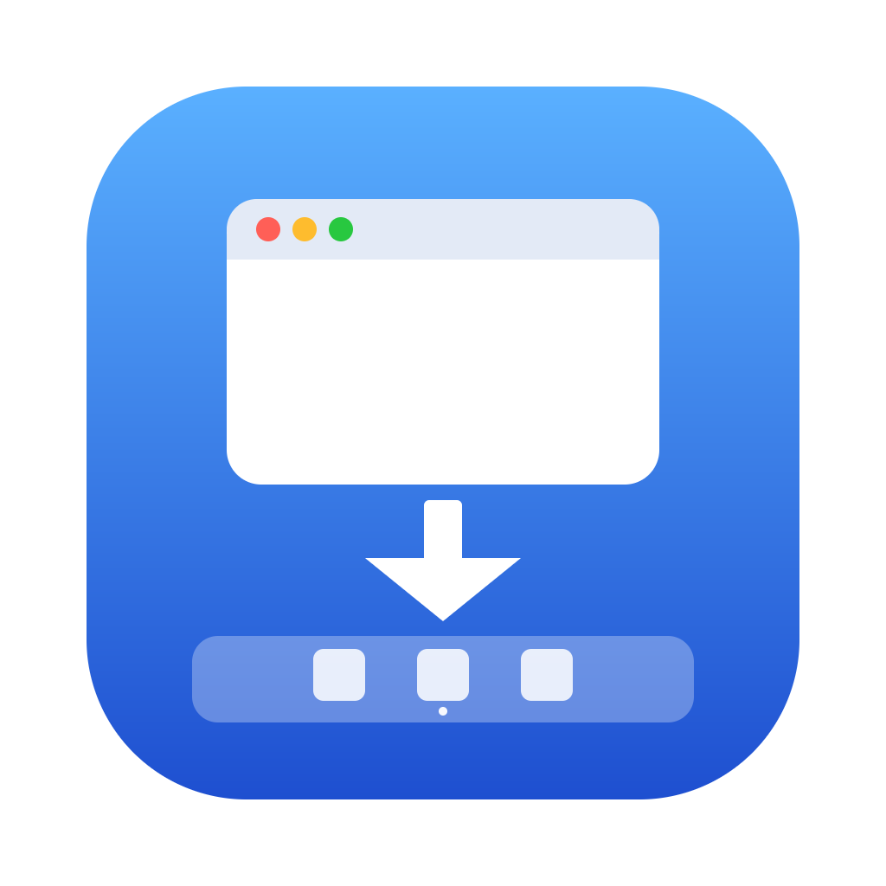

# Dockus

A small macOS menu bar utility that brings Windows taskbar behavior to the Dock:
clicking the Dock icon of the active application minimizes its windows, and clicking it again restores them.

> **Disclaimer.** Dockus was written for personal use. It is provided as is, without any warranty or support.
> The author accepts no responsibility for any damage, data loss or other consequences of using it. Use at your own risk.

## Behavior

- Click the Dock icon of the active application that has visible windows: all its windows are minimized to the Dock.
- Click the Dock icon of an application whose windows are all minimized: all its windows are restored and the
  application is activated.
- Any other click (launching an application, switching to an inactive one, an application without windows) is handled
  by the Dock as usual.
- Only standard windows in the current Space are affected. Full-screen windows cannot be minimized and are left alone.
- Right-click, Cmd-click, Option-click, drag, folders, stacks and the Trash are not affected.
- Only one instance runs at a time. A second launch exits immediately.

## Requirements

- macOS 12 Monterey or later, Apple silicon or Intel (universal binary).
- Accessibility permission (needed to read Dock items and minimize windows).

## Resource usage

- Swift and AppKit only, no third-party dependencies.
- Event-driven: no timers or polling, near-zero CPU when idle. The only timer runs every 2 seconds while the
  Accessibility permission is missing and stops once it is granted.
- Memory footprint: about 23 MB RSS (measured on macOS 15 in the end-to-end test).
- No network access, no telemetry, no update checks.

## How it works

1. A `CGEventTap` listens for left mouse down and up events.
2. On mouse down, `AXUIElementCopyElementAtPosition` finds the element under the cursor.
   The click is handled only if the element belongs to the Dock process and has the subrole `AXApplicationDockItem`.
3. The item's `AXURL` identifies the application bundle, which is matched to an `NSRunningApplication`.
   If the paths differ (for example, Safari in a cryptex), the Dock item title is matched to the application name.
4. If that application is frontmost and has unminimized windows, Dockus sets `kAXMinimizedAttribute` on each window
   and consumes the click and its matching mouse up.
   If all its windows are minimized, Dockus restores them and passes the click on, so the Dock activates the application
   (since macOS 14 one application cannot reliably activate another). Other clicks pass to the Dock unchanged.
   Minimized windows report the subrole `AXDialog`, so they are matched by their minimized state, not by subrole.
5. Clicks with Cmd, Option, Control or Shift held are always passed to the Dock.
6. Accessibility calls time out after 0.5 seconds, so an unresponsive application cannot stall mouse input.
7. If macOS disables the tap (`kCGEventTapDisabledByTimeout`), Dockus enables it again.

Single instance: on startup Dockus takes an exclusive non-blocking `flock` on
`~/Library/Application Support/<bundle id>/instance.lock`. If the lock is held, the process exits before creating the
event tap or the menu bar item. The operating system releases the lock when the process ends, including after a crash.

## Menu bar

Dockus runs as an agent application (`LSUIElement`): no Dock icon, only a menu bar item. The menu bar item uses the
SF Symbol `dock.arrow.down.rectangle` as a template image, so it follows the light and dark menu bar without any
image files. The menu contains:

- **Enabled**: turns the Dock click handling on or off. The setting persists; the icon is dimmed while disabled.
- **Launch at Login**: writes or removes `~/Library/LaunchAgents/io.github.vdasus.Dockus.plist`.
  `SMAppService` is not used because it requires macOS 13. The plist stores the current app path, so set the option
  again after moving the app.
- **Quit Dockus**

If the Accessibility permission is missing, the menu shows **Grant Accessibility Access…**, which opens the relevant
System Preferences pane. Dockus starts working as soon as access is granted; no restart is needed.

## Installation

1. Download the latest zip from [Releases](https://github.com/vdasus/Dockus/releases).
2. Unzip it and move `Dockus.app` to `/Applications`.
3. Remove the quarantine attribute. The app is not notarized, so Gatekeeper blocks it otherwise:

   ```bash
   xattr -dr com.apple.quarantine /Applications/Dockus.app
   ```

   On Monterey, right-click the app and choose **Open** as an alternative.
4. Start Dockus and grant access in **System Preferences → Security & Privacy → Privacy → Accessibility**.

### Updating

Release builds are signed with the same self-signed certificate, so the Accessibility permission survives updates.
After the first update from an ad-hoc signed build (1.1.0 or earlier), or after a build without the certificate (for
example, from a pull request), the permission is lost: run `tccutil reset Accessibility io.github.vdasus.Dockus` and
grant access again.

## Building

No macOS development tools are needed on the target Mac. Builds run on GitHub Actions macOS runners, which include Xcode.

The workflow:

1. Runs on `macos-15` on every push to `main`, on pull requests and on tags `v*`.
2. Runs [`build.sh`](build.sh), which builds a universal binary with `swift build -c release --arch arm64 --arch x86_64`.
3. Builds `AppIcon.icns` from `Resources/AppIcon.png` (1024×1024) with `sips` and `iconutil`.
   The application icon appears in Finder and in the Accessibility list.
4. Assembles `Dockus.app` with deployment target `12.0` and signs it with the self-signed certificate from GitHub
   Secrets (ad-hoc, `codesign -s -`, when the secrets are not available).
5. Zips the bundle and uploads it as a workflow artifact; a pushed tag publishes it as a GitHub Release.

Versions follow [Semantic Versioning](https://semver.org): increment the patch number for a fix, the minor number for
a new feature, the major number for a change that breaks existing behavior. The version comes from the tag and is shown
in the menu bar menu; untagged builds show the last tag with `-dev.<run number>`. To publish a release:

```bash
git tag v1.1.0
git push origin v1.1.0
```

GitHub Actions minutes are free for public repositories.

### Building locally

On a Mac with Xcode (the universal build needs Xcode, not only the Command Line Tools):

```bash
./build.sh   # produces build/Dockus.app and build/Dockus.zip
```

### Debug log

Set `DOCKUS_DEBUG` to print one line per handled Dock click to standard error:

```bash
open --env DOCKUS_DEBUG=1 --stderr /tmp/dockus.log /Applications/Dockus.app
```

## Testing

Every CI run executes [`Tests/e2e.sh`](Tests/e2e.sh) on the macOS runner against the built `Dockus.app`:

1. Checks that the SF Symbol for the menu bar icon is available on macOS 12.
2. Grants Accessibility to Dockus and to a test driver app by writing to the system TCC database. This works only
   because SIP is disabled on GitHub-hosted runners; do not run the script on a personal Mac.
3. Baseline: without Dockus, a click on the driver's Dock icon leaves its windows alone.
4. Starts Dockus and checks that a second instance exits and only one process remains.
5. With Dockus: the driver checks the menu bar item, then clicks its own Dock icon with synthetic mouse events.
   The first click must minimize both its windows, the second must restore both and leave the app active,
   and a Cmd-click must not minimize anything.
6. Prints the Dockus debug log and memory usage.

On failure, the workflow uploads the logs and a screenshot as the `e2e-diagnostics` artifact.

### Stable signing

macOS ties the Accessibility permission to the designated requirement of the code signature. An ad-hoc signature
changes on every build; a signature made with the same certificate does not. The workflow imports a self-signed code
signing certificate (common name `Dockus Self-Signed`) from the GitHub Secrets `SIGNING_P12` (base64 of a `.p12` file)
and `SIGNING_PASSWORD` into a temporary keychain and passes it to `build.sh` as `SIGN_IDENTITY`. No Apple Developer
Program membership is needed. Local builds sign ad-hoc unless `SIGN_IDENTITY` is set.

To create a new certificate (every installed copy then needs the permission granted once more):

```bash
openssl req -x509 -newkey rsa:2048 -nodes -days 7300 -subj "/CN=Dockus Self-Signed" \
  -addext "basicConstraints=critical,CA:false" -addext "keyUsage=critical,digitalSignature" \
  -addext "extendedKeyUsage=critical,codeSigning" -keyout key.pem -out cert.pem
openssl pkcs12 -export -inkey key.pem -in cert.pem -name "Dockus Self-Signed" \
  -keypbe PBE-SHA1-3DES -certpbe PBE-SHA1-3DES -macalg sha1 -out dockus.p12
base64 -i dockus.p12 | gh secret set SIGNING_P12
gh secret set SIGNING_PASSWORD
```

## License

Public domain under [The Unlicense](LICENSE): anyone may use, copy, modify and distribute it for any purpose,
without restrictions.
